# Auth & Authorization — Deep Dive

This document is the **canonical reference** for how authentication, session
management, and authorization work in Vuestrata. It complements the high-level
overview in [auth-rbac.md](./2.auth-rbac.md) by explaining the internals,
control flow, and security rationale of every moving part.

> **Audience:** maintainers extending the auth/RBAC system, reviewers auditing
> security-relevant changes, integrators wiring a real backend.

---

## 1. Architecture at a glance

The auth subsystem is deliberately split between **platform infrastructure**
that boots before the module system, and a dedicated **`auth` feature module**
that owns the user-facing surface:

- **Infrastructure (loads at bootstrap, before any module):** the auth Pinia
  store, the API auth-interceptor, the router guard, and the RBAC engine all
  live under `src/modules/app/` and `src/modules/core/`. They must be available
  the moment any other module installs, so they cannot be modules themselves.
- **Feature module (`src/modules/auth/`):** owns the `useAuth` composable,
  PKCE helpers, mock handlers, and the `/auth/login`, `/auth/register`,
  `/auth/callback` pages. It is registered first in the module list, marked
  `required: true` so it cannot be disabled at runtime, and contributes its
  MSW handlers via the standard `mockHandlers()` hook.

The auth subsystem is split across four collaborating layers:

| Layer                            | File                                                                                                                                                       | Responsibility                                                                              |
| -------------------------------- | ---------------------------------------------------------------------------------------------------------------------------------------------------------- | ------------------------------------------------------------------------------------------- |
| **Store (state)**                | [src/modules/app/stores/auth.ts](../../src/modules/app/stores/auth.ts)                                                                                     | Holds tokens & user **in memory**, schedules proactive refresh, never imports adapter code. |
| **Composable (orchestration)**   | [src/modules/auth/composables/useAuth.ts](../../src/modules/auth/composables/useAuth.ts)                                                                   | Selects an adapter, drives login/register/MFA/OAuth/magic-link flows, owns lockout state.   |
| **Adapter (transport)**          | [src/modules/auth/adapters/](../../src/modules/auth/adapters/) — one file per strategy                                                                     | Translates auth operations into HTTP calls, and declares its transport + capabilities.      |
| **API interceptor (resilience)** | [src/modules/core/lib/api/auth-interceptor.ts](../../src/modules/core/lib/api/auth-interceptor.ts) + [client.ts](../../src/modules/core/lib/api/client.ts) | Injects the bearer token, handles 401 → refresh → retry, dedups concurrent refreshes.       |

The RBAC engine sits beside this stack:

| Layer                       | File                                                                  | Responsibility                                                                         |
| --------------------------- | --------------------------------------------------------------------- | -------------------------------------------------------------------------------------- |
| **Registry**                | [rbac/registry.ts](../../src/modules/core/lib/rbac/registry.ts)       | Tracks all known permission strings (built-in + module-contributed).                   |
| **Hierarchy & inheritance** | [rbac/inheritance.ts](../../src/modules/core/lib/rbac/inheritance.ts) | Resolves delta-defined roles into full permission sets.                                |
| **Checks**                  | [rbac/checks.ts](../../src/modules/core/lib/rbac/checks.ts)           | `hasPermission` / `hasAnyPermission` / `hasAllPermissions`.                            |
| **Predicates**              | [rbac/predicates.ts](../../src/modules/core/lib/rbac/predicates.ts)   | Optional resource-scoped overrides (ownership, tenancy, etc.).                         |
| **Hooks**                   | [rbac/hooks.ts](../../src/modules/core/lib/rbac/hooks.ts)             | Pub/sub for every authorization decision (audit, analytics).                           |
| **Composable**              | [useRbac.ts](../../src/modules/app/composables/useRbac.ts)            | Component-facing API with three-tier user-source resolution.                           |
| **Router guard**            | [plugins/router.ts](../../src/modules/app/plugins/router.ts)          | Enforces `meta.requiresAuth` / `requiredRole` / `requiredPermission(s)` on navigation. |

### Component diagram

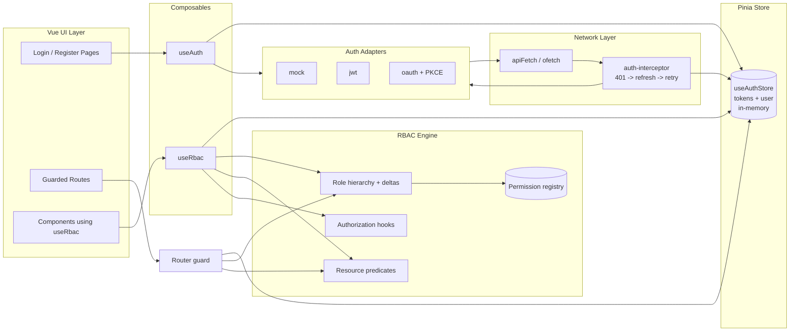

---

## 2. Token storage & session lifetime

### Session state machine

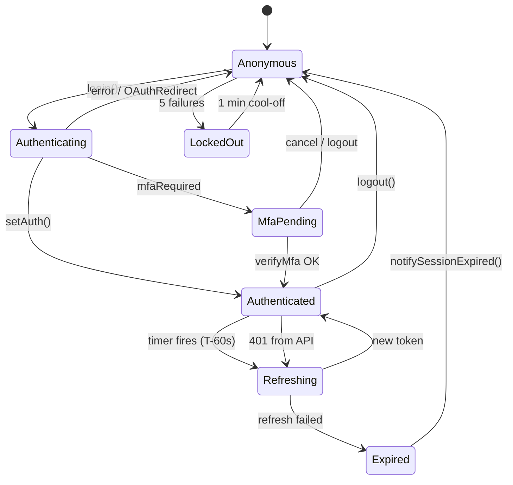

### Why the access token is in-memory only

The **access token** and the `User` object live only inside the Pinia store —
never in `localStorage` or `sessionStorage`, under any configuration.

This is a deliberate XSS-mitigation strategy:

- Any persisted token is reachable by injected JS. By keeping the access token
  in JS closures (the store's reactive refs), an attacker who already has script
  execution cannot exfiltrate the bearer via the storage APIs.
- A real backend should set the **refresh token in an `HttpOnly; Secure`
  cookie** so it is unreachable by JS entirely. That is what
  `VUESTRATA_SESSION_PERSISTENCE=refresh-cookie` (the production default)
  expects, and it is the only mode where no long-lived credential is readable
  by script. Under it the `jwt` adapter sends `credentials: 'include'` on every
  `/auth/*` request, so the cookie is stored at login, presented on refresh and
  cleared on logout; what the backend has to do in return is listed in
  [Environment](1.environment#what-refresh-cookie-needs-from-the-backend).

The **refresh token** is the one value a deployment may choose to persist, and
only through `VUESTRATA_SESSION_PERSISTENCE` — see
[Environment](1.environment). Without one of those modes there is no credential
at boot and a reload genuinely ends the session.

::alert{type="warning"}
This used to be broken rather than configurable. `restoreSession()` opened with
`if (!authStore.token) return`, and on a cold boot there is never a token —
so the restore was unreachable for **both** real adapters and every refresh
signed the user out. Under cookie transport the session cookie was still valid
and the app never asked. See §6.
::

### Demo-Mode Persistence

In a **demo build** the mock adapter supplements the in-memory store with
**IndexedDB persistence** so demo sessions survive page reloads:

- `src/modules/app/state/demo/index.ts` — the single barrel. Every application-code path into demo state goes through here, behind `if (__VUESTRATA_DEMO__)`, via a dynamic `import()`. That guard is what lets rolldown remove the whole subtree from a production bundle.
- `src/modules/app/state/demo/account.ts` — the demo credentials, defined once and shared by the login hint, the MSW handler, the seed routine, and the e2e helpers.
- `src/modules/app/state/demo/seed.ts` — seeds the demo super-admin with every permission in the RBAC registry, and reconciles its grants (and those of a signed-in demo session) on every boot. Called from exactly one place: the `__VUESTRATA_DEMO__` branch of `boot()` in `bootstrap/index.ts`, after `setupModules()` so module-contributed permissions are registered first.
- `src/modules/app/state/demo-persistence.ts` — low-level IndexedDB helper with in-memory fallback for environments where IndexedDB is unavailable (SSR, unit tests).
- `src/modules/app/state/demo-storage.ts` — wraps records in a `DemoEnvelope` (version, `expiresAt`, `integrityHash`). Envelopes failing validation are discarded fail-closed.
- `src/modules/app/state/demo-store.ts` — typed `getDemoSession` / `setDemoSession` / `clearDemoSession`.
- Cross-tab sync via a `BroadcastChannel`, named by `DEMO_CHANNEL_NAME` in `demo-storage.ts`.

`integrityHash` is a **salted SHA-256 digest, not an HMAC**, and its salt is a
public constant in the client bundle. It catches accidental corruption and
version skew; it is not tamper resistance and not a security boundary.

This path is entirely separate from the production token lifecycle. Real
adapters (jwt/oauth) never touch IndexedDB, and in a production build none of
these modules are present at all — `scripts/build/verify-bundle.mjs` fails CI if
any of them reappear.

### Store surface

The store is intentionally minimal and **framework-agnostic** — it never
imports adapters or fetch logic.

```ts
// src/modules/app/stores/auth.ts (excerpt)
const user = ref<User | null>(null)
const token = ref<string | null>(null)
const refreshToken = ref<string | null>(null)

let refreshTimer: ReturnType<typeof setTimeout> | null = null
let refreshHandler: (() => void | Promise<void>) | null = null

// Cookie transport has no client-visible token; the HttpOnly cookie is the
// credential. See §6.
const isAuthenticated = computed(
  () => !!user.value && (!!token.value || getAuthTransport() === 'cookie'),
)
```

Public actions: `setAuth`, `setUser`, `clearAuth`, `setRefreshHandler`,
`scheduleTokenRefresh`, `clearRefreshTimer`.

`userPermissions` is the resolved set — the user's explicit `permissions` when
the backend sent them, otherwise what the role grants (see §8). `clearAuth(reason?)`
emits `auth.logout` on the event bus with `{ reason?: 'logout' | 'expired' }`
once the session is gone; §7 covers who listens.

### Proactive refresh scheduler

`setAuth(user, token, refreshToken, expiresIn)` calls
`scheduleTokenRefresh(lifetime)`, where the lifetime is the JWT's own `exp` when
the token has one and `expiresIn` otherwise. With neither, nothing is scheduled
and the session refreshes only on a 401. The scheduler:

1. Cancels any existing timer.
2. Computes `refreshInMs = max((lifetime - 60) * 1000, 5000)` — refresh 60 s
   before expiry, never sooner than 5 s from now — and caps it at
   `2^31 - 1` ms (about 24.8 days). `setTimeout` keeps its delay in 32 signed
   bits, and a longer one overflows and fires at once, into a refresh that
   answers with the same lifetime. A month-long token is refreshed early
   instead. A lifetime that is not a finite number schedules nothing.
3. Schedules a `setTimeout` whose handler **re-checks `token.value`** before
   firing. If it is null (user logged out, a 401 already cleared the session),
   the handler is skipped.

It does **not** depend on a refresh token held in JavaScript. It used to, and
under `refresh-cookie` — where there is none by design — the timer fired and
returned at once, so every session ran into a 401 at the end of each
access-token lifetime.

The refresh callback itself is supplied at boot, by `setupAuthInterceptor()` in
`src/modules/app/bootstrap/auth-wiring.ts` (`main.ts` only calls `boot(App)`).
It asks the adapter, which knows which credential its deployment presents:

```ts
authStore.setRefreshHandler(async () => {
  // The session this timer fired for; see "A refresh that outlives its session".
  const startedIn = sessionEpoch
  try {
    if (refreshSession) {
      if (!canRefresh()) return
      // Shared with the 401 path: whichever asks second joins the request
      // already in flight, so a rotating refresh credential is presented once.
      const result = await refreshOnce()
      if (startedIn !== sessionEpoch) return
      if (result?.token && authStore.user) {
        authStore.setAuth(authStore.user, result.token, result.refreshToken, result.expiresIn)
      }
      return
    }
    // An adapter without `refreshSession` (the demo's, or one written before
    // 1.1): rotate the refresh token the store holds, if there is one.
    …
  } catch (err) {
    logger.warn('Proactive token refresh failed — falling back to 401 interceptor', { err })
  }
})
```

The store stays adapter-free; the auth layer injects the strategy at startup.

---

## 3. Adapters

### Adapter class diagram

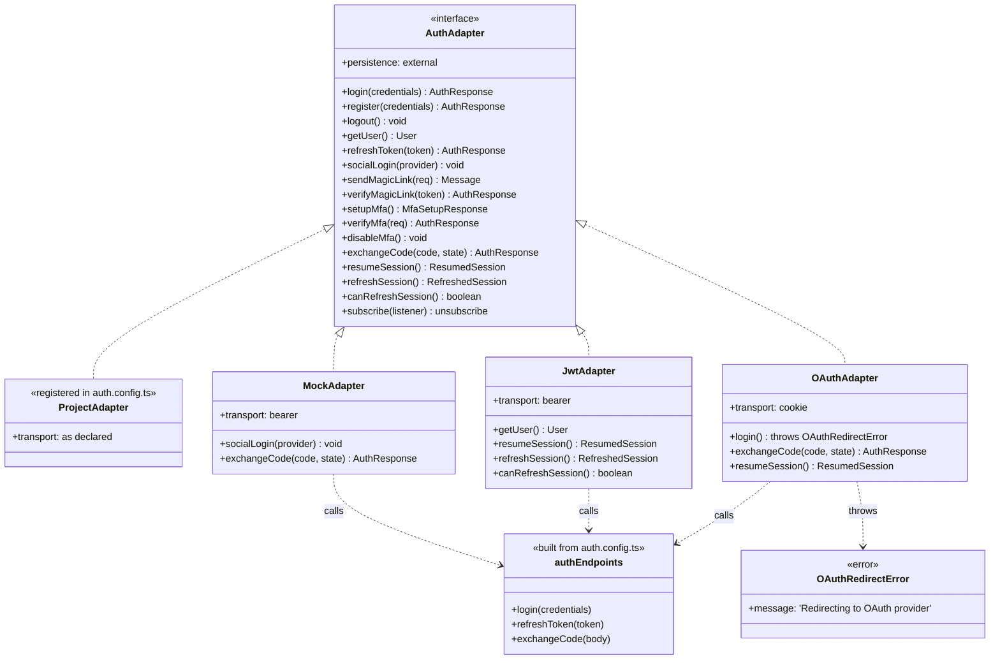

None of the three wraps another. Each assigns the wire calls it uses from
`authEndpoints` — one `apiFetch` call per endpoint — and adds only what is its
own: the JWT adapter's expiry check and refresh-credential resume, the OAuth
adapter's PKCE redirect and code exchange, the mock adapter's provider-less
social sign-in and demo-session cleanup.

The wire calls are not literals. `createAuthEndpoints()` in
`core/lib/auth/endpoints.ts` builds them from an endpoint table and a set of
response mappers, and both come from the project's `app/config/auth.config.ts`. With that
file empty the table is `endpointPresets.vuestrata` and the mapper takes the
body as it is, which is the contract documented in
[Auth & RBAC](2.auth-rbac#backend-endpoints); `test/integration/auth/default-wire-contract.test.ts`
holds the default to it request by request. The mock adapter is the exception:
it always uses the default table, because its backend is the service worker.

The `AuthAdapter` interface is the only contract every strategy must satisfy:

```ts
interface AuthAdapter {
  readonly name: SupportedAuthAdapter | (string & {}) // a built-in name, or a registered one
  readonly transport: AuthTransport // 'bearer' | 'cookie'
  readonly capabilities: AuthCapabilities

  // Required — every adapter can start a session, end one, identify the user.
  login: (credentials: AuthCredentials) => Promise<AuthResponse>
  logout: () => Promise<void>
  getUser: () => Promise<User | null>

  // Optional — presence must match the matching `capabilities` flag.
  register?: (credentials: AuthCredentials & { name: string }) => Promise<AuthResponse>
  refreshToken?: (token: string) => Promise<AuthResponse>
  socialLogin?: (provider: AuthProviderId) => Promise<void>
  sendMagicLink?: (request: MagicLinkRequest) => Promise<{ message: string }>
  verifyMagicLink?: (token: string) => Promise<AuthResponse>
  setupMfa?: () => Promise<MfaSetupResponse>
  verifyMfa?: (request: MfaVerifyRequest) => Promise<AuthResponse>
  disableMfa?: () => Promise<void>
  exchangeCode?: (code: string, state: string) => Promise<AuthResponse>
  // Boot-time session recovery; see §6. Not capability-gated: there is no UI to hide.
  resumeSession?: () => Promise<ResumedSession | null>
  // Mid-session refresh with whichever credential the deployment uses; see §5.
  // Null when there is nothing to present; rejects when the backend refuses.
  refreshSession?: () => Promise<RefreshedSession | null>
  canRefreshSession?: () => boolean
  // For an adapter whose session an SDK keeps: the changes the SDK makes to it.
  subscribe?: (listener: (change: AuthStateChange) => void) => () => void
  // 'external': the SDK stores the session; the app is never handed a refresh token.
  persistence?: 'external'
}
```

`refreshSession`, `canRefreshSession`, `subscribe` and `persistence` are
optional and feature-detected by the bootstrap
(`typeof adapter.refreshSession === 'function'`). An adapter without the first
two keeps the refresh the interceptor has always made itself: a
`{ refreshToken }` body, which needs a refresh token held in JavaScript. None of
the built-in adapters has the last two: every change to their session is the
answer to a request the app made.

An adapter with `subscribe` is subscribed to once, by `setupAuthInterceptor`.
`{ session }` is written to the store (`setAuth`, or `setUser` under cookie
transport); `{ session: null }` clears it and, on a protected route, sends the
visitor to the login page with the way back, adding `reason=expired` only when
the adapter said so. With `persistence: 'external'` the registry removes
`refreshToken` from every session the adapter returns, so the store has none to
write to Web Storage under any `VUESTRATA_SESSION_PERSISTENCE`.

What is announced is not written as it comes, because an announcement can be
late and can be for somebody else. The refresh path has `sessionEpoch` for the
same reason (§5). The rules, which are the contract on `AuthAdapter.subscribe`:

| Situation                                                         | What the bootstrap does                                                                                                                                |
| ----------------------------------------------------------------- | ------------------------------------------------------------------------------------------------------------------------------------------------------ |
| A change carries a `sequence` lower than one already received     | Dropped. A session established later is never replaced by one announced earlier                                                                        |
| The session announced is for a different user than the store's    | The current session is ended first (`clearAuth('logout')`: one `auth.logout`, query cache dropped, refresh in flight discarded), then the new user set |
| A session is announced after the app ended one itself in this tab | Ignored, until the app signs somebody in, or the adapter reports `{ session: null }` **with a `sequence`**                                             |
| `{ session: null }`                                               | The store is cleared. It is the SDK's own report, so a session it announces afterwards is a new sign-in                                                |
| The announced user does not fit `User`                            | Ignored, with one contract error logged (field paths, never the payload)                                                                               |
| A session with no `token` under bearer transport                  | Ignored                                                                                                                                                |

`sequence` is a number the adapter supplies that never goes down from one
change to the next: a counter it increments when the SDK reports a change,
read before any `await`. It is optional, and the bootstrap can only enforce
order for an adapter that supplies it; one that does not is taken at its word.
In return the adapter owes two things: changes in the SDK's order (dropping
the result of asynchronous work that a later event overtook), and a `logout()`
that really ends the SDK's session.

Every adapter a project registers is also held to the `User` contract by the
registry, whatever it does itself: the user of each session it answers with,
and of `getUser()`, goes through `parseUser`. One that does not fit rejects a
sign-in with `CONTRACT_MISMATCH`, and reads as "no session" from
`resumeSession()` and `getUser()`.

Two deliberate design points:

- **Optional methods plus `capabilities`.** All eleven used to be required, so
  an adapter that could not honour one either threw at call time or silently
  no-oped. Now the UI reads `capabilities` and hides the affordance instead.
  `requireCapability()` guards each call and throws an error naming the adapter
  and the capability.
- **`exchangeCode` is on the interface.** It used to be a free function the
  callback page imported directly, which left the flow's most
  security-sensitive step outside the contract entirely.

`createAuthAdapter(name)` builds an adapter from the registry: the built-in
ones (`adapters/registry.ts`), plus whatever the project lists under `adapters`
in `auth.config.ts` (`core/lib/auth/registry.ts`).

```ts
export function registeredAuthAdapters(): string[]
export function resolveAuthAdapterName(adapterName: string | undefined): AuthAdapterName
export function createAuthAdapter(
  adapterName: string | undefined,
  options?: { getToken?: () => string | null; getRefreshToken?: () => string | null },
): AuthAdapter
export function loadAuthAdapter(adapterName: string | undefined): Promise<void>
```

`createAuthAdapter` is synchronous. A project's adapter registered with
`load: () => import(…)` is a separate chunk, so it has to be fetched first:
`loadAuthAdapter(name)` does that, `boot()` awaits it once before it wires auth,
and from then on `createAuthAdapter(name)` just works. For every other adapter
`loadAuthAdapter` resolves at once.

`getToken` is threaded in for the JWT adapter's expiry check, and
`getRefreshToken` for the refresh token it presents when one is held in memory —
callbacks rather than values, since the adapter is built once and the tokens
rotate.

`resolveAuthAdapterName` throws for a name that is neither built in nor
registered, naming `auth.config.ts`. It used to answer with `'mock'` and a
warning, which sent a mistyped production deployment to endpoints that exist
only inside the demo's service worker. The build refuses such a name first (the
env schema is given the registered names by the Vite plugin, which reads them
from `auth.config.ts` without running it), and a boot that still meets one
shows the failure screen. No name at all is the mode default: `mock` in a demo
build, `jwt` otherwise.

`AuthAdapterName` is the built-in names plus whatever the project declares in
`RegisteredAuthAdapterNames`, an empty interface it extends from
`auth.config.ts` (`declare module '~/lib/auth' { … }`). `RuntimeEnv.authAdapter`
and `appConfig.authProvider` have that type, so for a project that registers
nothing they are the built-in names: `'mock' | 'jwt' | 'oauth' | 'session'`.
`session` joined them in 1.1.0, and the migration of that release retypes the
`authProvider` line of an upgraded project’s `app/types/index.ts` to
`AuthAdapterName`, so the next name needs no edit there. The build warns when the names declared and the adapters registered
differ.

The mock adapter is referenced only behind `__VUESTRATA_DEMO__`, so a
production bundle does not contain it. `verify-bundle.mjs` checks. The
`session` adapter is referenced only behind `__VUESTRATA_SESSION_ADAPTER__`,
which the build sets when `VUESTRATA_AUTH_ADAPTER=session`: a bundle built for
another adapter does not carry it.

Each adapter lives in its own file under
[src/modules/auth/adapters/](../../src/modules/auth/adapters/), sharing the wire
calls built in `core/lib/auth/endpoints.ts`. They previously all lived in one
606-line file.

The contract, the configuration and the wire layer are in `core/lib/auth/`
rather than in the auth module for a reason that has nothing to do with
layering: `auth.config.ts` is typed against them and the bootstrap installs
them, and both are files an upgrade delivers into a project whose auth barrel
(`src/modules/auth/index.ts`) is its own and may predate them. `core/lib` is
Vuestrata's everywhere, so that is where a project's files import them from:
`~/lib/auth`. `test/unit/auth/auth-seam-ownership.test.ts` keeps it that way.

### Mock adapter

`transport: 'bearer'`. Hits the MSW handlers in
[src/modules/auth/mocks/auth.handlers.ts](../../src/modules/auth/mocks/auth.handlers.ts).
Demo builds only — the env schema rejects `mock` outside demo mode. It mints an
unsigned JWT so the demo exercises the same header path a real bearer backend
would, and validates the seeded account's password against `DEMO_ACCOUNT`.

### JWT adapter

`transport: 'bearer'`. Credentials plus access/refresh tokens, with
**token-expiry awareness** in `getUser`:

```ts
export function isJwtExpired(token: string): boolean {
  const payload = jwtDecode<{ exp?: number }>(token)
  // No exp is treated as expired: a non-expiring access token is either a
  // misconfiguration or not an access token. Fail closed.
  if (!payload.exp) return true
  return Date.now() >= (payload.exp - 30) * 1000 // 30 s clock-skew margin
}
```

`getUser` returns `null` without issuing a request when the held token is
already expired, so session restoration does not burn a round trip or trip the
401 interceptor.

> **Previously:** `createJwtAdapter()` was literally `return createBaseAdapter()`
> — a no-op wrapper. `isJwtExpired` existed but was called from nowhere, so the
> behaviour documented above did not happen, and a missing `exp` was treated as
> _valid_ rather than expired.

It also owns the refresh request, in one function both `resumeSession()` and
`refreshSession()` use:

| `VUESTRATA_SESSION_PERSISTENCE` | `POST /auth/refresh`                                                     |
| ------------------------------- | ------------------------------------------------------------------------ |
| `refresh-cookie`                | no body, `credentials: 'include'`: the backend reads its HttpOnly cookie |
| `session`, `local`              | `{ refreshToken }` from memory, else from Web Storage                    |
| `none`                          | `{ refreshToken }` from memory; nothing to send after a reload           |

One exception, for a project that left the default in place over a body-token
backend: when a response did put a `refreshToken` in its body under
`refresh-cookie`, the adapter sends it back as `{ refreshToken }` (cookies still
attached) instead of an empty request that backend would refuse. It is held in
memory only, so a reload still depends on the cookie.

The request never carries `Authorization`: by the time a 401 triggers it the
access token is the expired one, and a backend that validates the header
wherever it appears would refuse the refresh before reading its credential.

Under `refresh-cookie`, `authEndpoints` (built in `core/lib/auth/endpoints.ts`) sends
`credentials: 'include'` on every auth call, wherever `auth.config.ts` points
it, and nowhere else. The API
client would otherwise send `omit` — this is a bearer adapter — and a browser
neither stores nor sends a cookie for an `omit` request, so the login could
never set the cookie the refresh then needs. Every `/auth/*` call also passes
`skipAuthRefresh`: a 401 from one of them is its answer, not an expired token.

### OAuth adapter

Implements **Authorization Code with PKCE** (RFC 7636). Helpers live in
[src/modules/auth/lib/pkce.ts](../../src/modules/auth/lib/pkce.ts):

- `generateCodeVerifier()` — 64-byte cryptographic random string.
- `generateCodeChallenge(verifier)` — `BASE64URL(SHA256(verifier))`.
- `generateState()` — opaque CSRF nonce stored in `sessionStorage` for
  validation when the provider redirects back.

`login()` triggers the redirect and **throws `OAuthRedirectError`**:

```ts
throw new OAuthRedirectError()
```

This sentinel is critical. The previous implementation returned a
never-resolving promise, which caused awaiters to hang and the lockout
counter to mistakenly increment. The composable now detects it:

```ts
catch (e) {
  if (e instanceof OAuthRedirectError) {
    // Not a failure — page is being replaced by the IdP redirect.
    return
  }
  recordFailedAttempt()
  throw e
}
```

### Cookie sessions (the session adapter)

`transport: 'cookie'`. The backend keeps the session and names it in an
HttpOnly cookie; state-changing requests carry a CSRF token. This is how
Laravel Sanctum's SPA authentication, Django's `SessionAuthentication`, Rails,
Spring Security with `CookieCsrfTokenRepository` and ASP.NET cookie
authentication work, and it is the usual shape of "our own backend" when the
app and the API are served from the same site.

There is no token in JavaScript at any point: nothing in memory, nothing in
storage, no `Authorization` header. A login answer that carries a token anyway
is not kept.

```bash
VUESTRATA_AUTH_ADAPTER=session
VUESTRATA_SESSION_PERSISTENCE=none   # cookie transport: the build asks for it
```

Two lines of configuration name the backend. For Laravel with Sanctum:

```ts
// src/modules/app/config/auth.config.ts
import { defineAuthConfig, endpointPresets } from '~/lib/auth'

export default defineAuthConfig({
  endpoints: endpointPresets.sanctum,
  // Laravel's user record → User.
  mapUser: (raw) => {
    const user = raw as { id: number; name: string; email: string; role: string }
    return { id: String(user.id), name: user.name, email: user.email, role: user.role }
  },
})
```

```ts
// src/modules/app/config/api.overrides.ts
import { defineApiOverrides } from '~/lib/api/integration'
import { presets } from '~/lib/api/presets'

export default defineApiOverrides({ backend: presets.laravel })
```

The first says where the session routes are. The second says how this backend
hands over its CSRF token, what its "stale token" looks like (419) and how it
formats errors. They are two files because they answer two questions, and the
second applies to every request the app makes, not only to signing in.

`endpointPresets.sanctum` is `POST /login`, `POST /logout` and `POST /register`
at the **root of the backend's origin**, and the current user at `/user` under
the API (`GET /api/user`). Everything else is switched off, so the magic-link
and MFA controls are hidden. Spread it to change one:
`{ ...endpointPresets.sanctum, me: '/me' }`.

#### What the adapter does

| Moment               | Requests                                                                                                                                                                |
| -------------------- | ----------------------------------------------------------------------------------------------------------------------------------------------------------------------- |
| Sign in              | The CSRF strategy's prime step, if it has one (`GET /sanctum/csrf-cookie`); `POST` the login endpoint; then `GET` the `me` endpoint, unless the answer carried the user |
| Reload               | `GET` the `me` endpoint. The cookie speaks for itself                                                                                                                   |
| Sign out             | `POST` the logout endpoint, then the cached CSRF token is dropped                                                                                                       |
| The session runs out | Nothing. The next request is answered as unauthenticated, and the visitor is sent to sign in                                                                            |

A **204** from the login endpoint is an answer, not an error: Sanctum and
Django both answer that way, and the cookie in the response is the whole
result. A body that names nobody (Fortify's `{ "two_factor": false }`) is
followed by `me` in the same way.

A login the backend **refuses** keeps the backend's own message and field
errors, through the error mapper the preset brought: Laravel's 422 with
`{ message, errors }`, DRF's 400 with `non_field_errors`.

The CSRF token is fetched **before** the credentials are sent, even when the
page already holds one from an earlier visit, and forgotten after a sign-in and
after a sign-out: frameworks issue a new token with the new session, against
session fixation, and the old one must not be what the next write sends. A
sign-in refused over a stale token (Laravel's 419) is replayed once with a new
one, like any other write, and only once.

#### A route beside the API: `base: 'origin'`

Auth endpoint paths are relative to `VUESTRATA_API_URL`. Laravel serves its
session routes at the root while the API lives under `/api`, so `/login` would
become `/api/login`. An endpoint that says `base: 'origin'` is resolved against
the API's **origin** instead:

```ts
endpoints: {
  login: { path: '/login', base: 'origin' },
  logout: { path: '/logout', base: 'origin' },
  me: '/user', // under the API: /api/user
}
```

| `VUESTRATA_API_URL`            | `{ path: '/login', base: 'origin' }` | `'/user'`                           |
| ------------------------------ | ------------------------------------ | ----------------------------------- |
| `/api`                         | `/login` on the page's origin        | `/api/user`                         |
| `https://api.example.test/api` | `https://api.example.test/login`     | `https://api.example.test/api/user` |

The request is still the API's as far as the client is concerned (the same
origin is what it goes by), so it carries cookies, the CSRF header and whatever
`api.overrides.ts` adds. The CSRF prime step is resolved the same way:
`/sanctum/csrf-cookie` lands at the root of the API's origin. `base` does not
apply to `authorize` and `providerAuthorize`, which are addresses the browser is
sent to; write those as absolute URLs.

#### Other backends

There is no preset for Django: Django itself has no JSON login endpoint, and
the packages that add one are mounted wherever the project chooses. Name the
paths yours has. With
[dj-rest-auth](https://dj-rest-auth.readthedocs.io/en/latest/api_endpoints.html)
included under `/api/auth/`:

```ts
// auth.config.ts
export default defineAuthConfig({
  endpoints: {
    login: '/auth/login/',
    logout: '/auth/logout/',
    me: '/auth/user/',
    register: '/auth/registration/',
    refresh: null,
    magicLink: null,
    magicLinkVerify: null,
    mfaSetup: null,
    mfaVerify: null,
    mfaDisable: null,
  },
  mapUser: (raw) => {
    const user = raw as { pk: number; email: string; first_name: string; last_name: string }
    return { id: String(user.pk), email: user.email, name: `${user.first_name} ${user.last_name}` }
  },
})
```

```ts
// api.overrides.ts: the csrftoken cookie as X-CSRFToken, and DRF's 403s.
import { csrfPresets } from '~/lib/api/csrf'

export default defineApiOverrides({
  backend: presets.django,
  // Django sets the cookie from a view decorated with ensure_csrf_cookie.
  // Point `prime` at one, so a first visit can sign in.
  csrf: { ...csrfPresets.django, prime: '/api/csrf/' },
})
```

| Backend               | `auth.config.ts`          | `api.overrides.ts`                                  |
| --------------------- | ------------------------- | --------------------------------------------------- |
| Laravel + Sanctum     | `endpointPresets.sanctum` | `backend: presets.laravel`                          |
| Django REST Framework | your paths, as above      | `backend: presets.django`, with a `prime` of yours  |
| Spring Security       | your paths                | `backend: presets.spring`                           |
| Rails                 | your paths                | nothing: `csrf_meta_tags` is the default strategy   |
| ASP.NET Core          | your paths                | `backend: presets.aspnet`, and a `csrf` of your own |

With nothing configured the adapter uses the documented Vuestrata paths
(`/auth/login`, `/auth/logout`, `/auth/me`) and the default CSRF strategy.

#### CSRF

A session cookie is attached by the browser to any request for the backend,
including one a hostile page provokes, so the backend expects a token that only
this app can read on every write. Where the token comes from is the `csrf`
strategy in `api.overrides.ts`, or the one the `backend` preset brings.

The default strategy reads `<meta name="csrf-token">`, which a server renders
into the page. **A statically hosted app has no such tag**, so with the session
adapter and nothing in `api.overrides.ts` every write would go out without a
token and come back refused. In development the app says so once at start,
naming the file. Name your backend there, or a strategy of your own, or
`csrf: { source: 'none' }` for a backend that relies on `SameSite` cookies
alone.

The token is in a cookie JavaScript **can** read; the session is in one it
cannot. A token cookie marked `HttpOnly` defeats the first (Django's
`CSRF_COOKIE_HTTPONLY` must stay `False`).

#### Cookies, sites and origins

| Deployment                                                             | What the backend has to do                                                                                                                                                                                                                                   |
| ---------------------------------------------------------------------- | ------------------------------------------------------------------------------------------------------------------------------------------------------------------------------------------------------------------------------------------------------------ |
| Same origin (`VUESTRATA_API_URL=/api`, behind one reverse proxy)       | Session cookie `HttpOnly; Secure; SameSite=Lax`. No CORS at all. The recommended arrangement                                                                                                                                                                 |
| Another origin on the same site (`app.example.com`, `api.example.com`) | The token cookie with `Domain=.example.com`, so the app's page can read it (the session cookie may stay the API's own). Credentialed CORS: an explicit `Access-Control-Allow-Origin`, `Access-Control-Allow-Credentials: true`, and the token header allowed |
| Another site (`app.one.example`, `api.two.example`)                    | Not a fit. The session cookie would need `SameSite=None; Secure` and is a third-party cookie, which browsers block or partition; the token cookie cannot be read from the app's page at all. Use a bearer adapter, or a proxy that makes it one site         |

For Laravel the second row is `SESSION_DOMAIN=.example.com`,
`SANCTUM_STATEFUL_DOMAINS=app.example.com` and `supports_credentials => true`
with the session routes listed under `paths` in `config/cors.php`. For Django it
is `SESSION_COOKIE_DOMAIN`, `CSRF_COOKIE_DOMAIN`, `CSRF_TRUSTED_ORIGINS` and
`CORS_ALLOW_CREDENTIALS`.

The build cannot check the server. When a cookie is not stored the sign-in
itself succeeds and the request after it is refused, which would read as a
wrong password. The adapter reports it as what it is:

```
Signed in, but the session did not reach the next request: the session cookie
was not stored or not sent.            (code: SESSION_NOT_ESTABLISHED)
```

and logs the list to check: `Secure` on a page served over http, `SameSite`,
`Domain`, credentialed CORS, and under `vp dev` the proxy (see
[Develop against your backend](../1.getting-started/4.develop-against-your-backend#a-backend-with-a-server-session)).

#### When the session ends

There is no refresh. The backend renews a server session as it is used and ends
it when it decides to; the app holds nothing it could present to get another.
`canRefreshSession()` answers `false`, and the adapter's `refreshSession()`
resolves to nothing, so the 401 path in §5 goes straight to its last step:

1. A request is answered as unauthenticated: a 401, or whatever the
   classifiers in `api.overrides.ts` read as one (DRF's 403 for an anonymous
   request, a redirect to a login page).
2. No refresh request is made, and nothing is replayed.
3. The store is cleared, and a visitor on a protected page is sent to
   `/auth/login?redirect=<where they were>&reason=expired`, once, however many
   requests found out together.
4. The login page says the session expired, and signing in returns them there.

#### When the backend cannot be asked

At boot the adapter asks the `me` endpoint whether the cookie is a session.
"Unauthenticated" is the ordinary answer for a visitor who is not signed in. A
network failure, a timeout or a 5xx is not an answer, and the session may be
perfectly valid. The app still starts: the visitor is treated as signed out
**for this page load** and sees the login page rather than an error screen,
which is what the `jwt` and `oauth` adapters do in the same position. Nothing
is ended by that. No logout is sent and there is nothing in JavaScript to
clear, so the cookie is untouched, and the next load, once the backend answers,
resumes the session.

#### In the bundle only when selected

The adapter is chosen when the app is built, so a bundle built for `jwt` or
`oauth` has no use for this one. The Vite plugin sets
`__VUESTRATA_SESSION_ADAPTER__`, and `adapters/registry.ts` references the
adapter only behind it, the way the mock adapter sits behind
`__VUESTRATA_DEMO__`.

#### Proven in a browser

`test/integration/auth/session-adapter.test.ts` pins the requests. What a
browser does with them (the cookie stored and sent, invisible to JavaScript,
the token read and decoded, an expiry that returns the visitor to their page)
is `e2e/integration/session.spec.ts`, against a stub backend that behaves like
Laravel with Sanctum:

```bash
node e2e/integration/build.mjs
vp exec playwright test -c e2e/integration/playwright.config.ts
```

The build runs in a temporary copy of the project, with the two files above in
place of the seeded ones, so nothing under `src/` is touched.

---

## 4. Login flow (step-by-step)

### Credentials login sequence

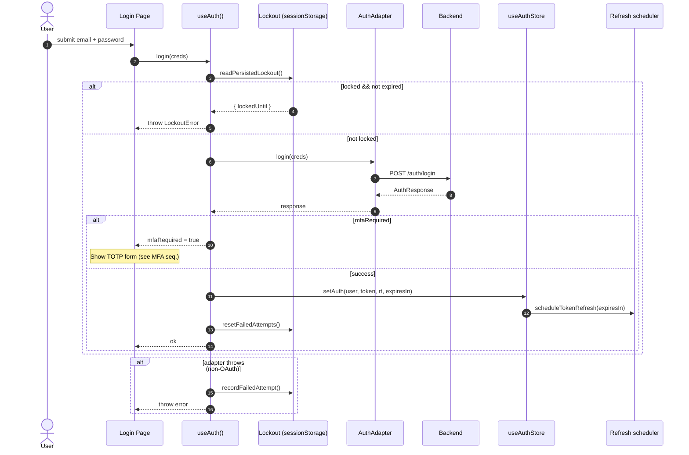

### MFA verification sequence

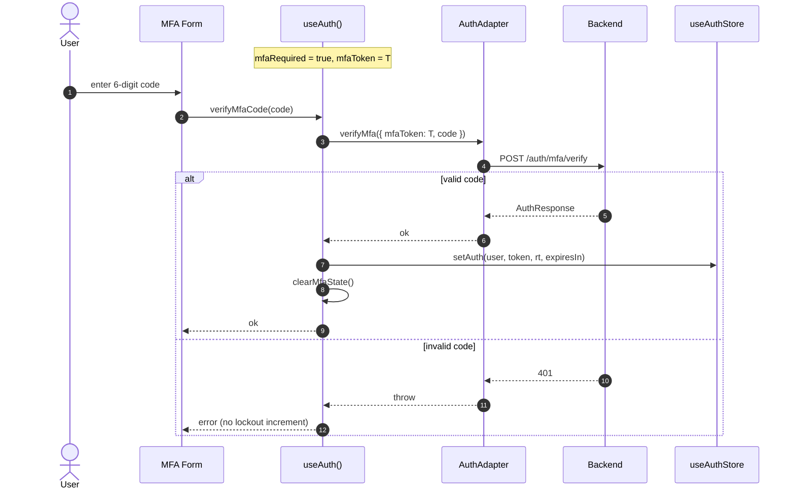

### OAuth (Authorization Code + PKCE) sequence

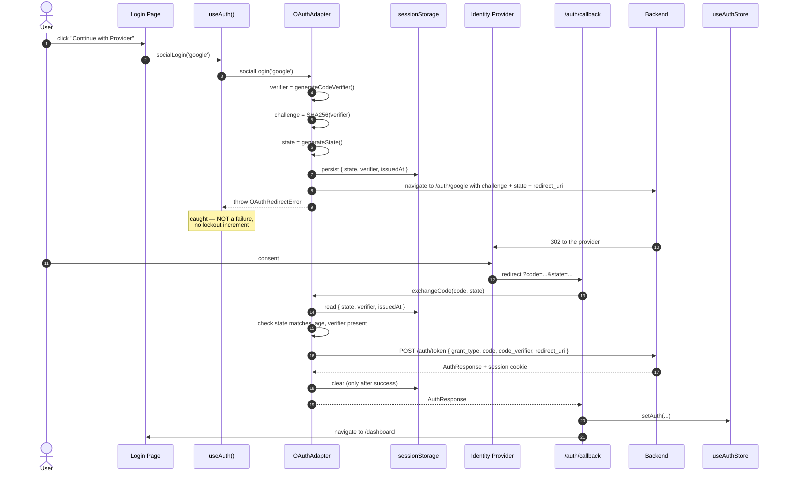

### Lockout state machine

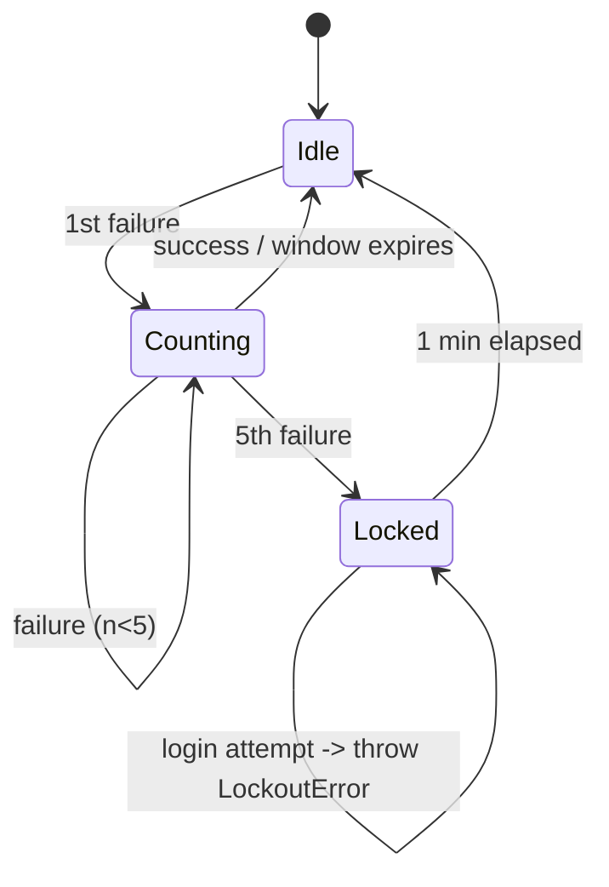

### Lockout

After **5 failed attempts**, login is blocked for **1 minute** (`LOCKOUT_DURATION_MS` in `auth/stores/challenge.ts`). This is a client-side UX guard held in `sessionStorage`, trivially bypassed by clearing storage — real brute-force protection must live on the backend.
State lives in `sessionStorage` under `vuestrata-auth-lockout`:

```jsonc
{
  "failedAttempts": 5,
  "firstFailedAt": 1745300000000,
  "lockedUntil": 1745300900000,
}
```

Module-scoped helpers (`readPersistedLockout`, `writePersistedLockout`,
`syncLockout`) keep the in-memory refs and storage in sync, and discard
expired records on read so a stale lockout cannot survive a slow tab
restore. **Why sessionStorage and not localStorage?** Lockout protects the
current browsing session from brute force; persisting across windows would
needlessly punish a different user on a shared machine.

### MFA

When the backend returns `{ mfaRequired: true, mfaToken }`, the composable
stores both in **module-level refs** (`mfaRequired`, `mfaToken`). The UI
binds to `useAuth().mfaRequired` to show a TOTP form, then calls
`verifyMfaCode(code)` which:

1. Posts `{ mfaToken, code }` to `adapter.verifyMfa`.
2. On success → `setAuth(...)` + `clearMfaState()`.
3. On failure → throws (lockout is **not** incremented; MFA failures use a
   separate counter governed by the backend).

`logout()` always calls `clearMfaState()` so a half-completed challenge
can never bleed into the next session.

---

## 5. API interceptor: 401 → refresh → retry

Every API call goes through `apiFetch` in
[src/modules/core/lib/api/client.ts](../../src/modules/core/lib/api/client.ts).

```
onRequest (exactly one of these, by the adapter's transport; a caller-set `Authorization` is kept):
   • bearer: add `Authorization: Bearer <token>` if logged in; credentials 'omit'
             (the jwt adapter's /auth/* calls pass 'include' under refresh-cookie)
   • cookie: add `X-CSRF-Token: <cached>` on mutating methods; credentials 'include'

on a 401:
   • Not for /auth/* requests, `skipAuthRefresh: true`, or a caller-set Authorization
   • handleTokenRefresh(...) — one refresh, shared by concurrent 401s
   • If refresh succeeded → replay the original request once, with the new bearer
   • If it failed, or the replay is refused too → notifySessionExpired() → the
     store is cleared ('expired') → from a protected route, router →
     /auth/login?redirect=<where they were>&reason=expired; the caller gets
     AppError `UNAUTHORIZED`
```

### Who makes the refresh request

`refreshAccessToken` no longer builds the request itself when the installed
provider can. `ApiAuthProvider` has two optional members:

```ts
interface ApiAuthProvider {
  // …
  /** Mint a new access token. Null: nothing to refresh with. A rejection is a failed attempt. */
  refresh?: () => Promise<{ token: string; refreshToken?: string; expiresIn?: number } | null>
  /** Whether `refresh()` has a credential to present right now. */
  canRefresh?: () => boolean
}
```

`bootstrap/auth-wiring.ts` wires them to the adapter's `refreshSession` /
`canRefreshSession` when the adapter has them, so the adapter decides what the
request looks like: a cookie and no body, or a `{ refreshToken }` body. That is
what lets a `refresh-cookie` session refresh mid-session at all — the old code
returned early when JavaScript held no refresh token, which under that mode is
always.

A provider without `refresh()` gets the request the interceptor always made: a
bare `ofetch` `POST` of `{ refreshToken }` to `refreshEndpoint`. A project that
installs its own provider keeps working unchanged.

Either way the interceptor keeps the single in-flight refresh, the cooldown and
up to three attempts for a failure that can clear (offline, 5xx). A `401` or
`403` from the refresh ends it at once: the credential was refused, and asking
again only delays the sign-in page.

### Refresh-on-401 sequence (single request)

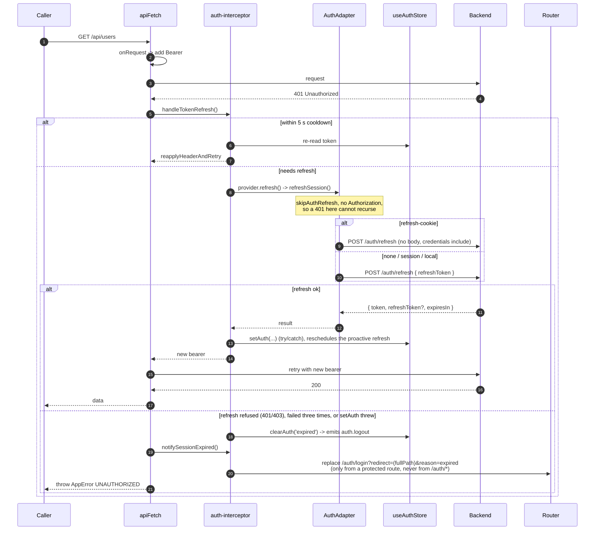

### Concurrent 401s — refresh dedup

```mermaid
sequenceDiagram
  autonumber
  participant R1 as Request A
  participant R2 as Request B
  participant R3 as Request C
  participant Int as auth-interceptor
  participant API as Backend

  par parallel 401s
    R1->>Int: 401 -> refresh?
    R2->>Int: 401 -> refresh?
    R3->>Int: 401 -> refresh?
  end
  Note over Int: refreshPromise == null -> create one
  Int->>API: POST /auth/refresh (single call)
  Note over R1,R3: A, B, C all await<br/>the SAME refreshPromise
  API-->>Int: { token, ... }
  Int-->>R1: new bearer
  Int-->>R2: new bearer
  Int-->>R3: new bearer
  Note over Int: lastRefreshedAt = now;<br/>requests arriving in next 5 s<br/>skip refresh entirely
```

### Refresh dedup with cooldown

`handleTokenRefresh` solves a textbook race: if 10 requests fly out in
parallel and all 10 receive 401, you must not trigger 10 refreshes.

```ts
// `backend` is what the app installs in core/lib/runtime.ts's API-auth slot
// (the `api-runtime` Pinia store). The in-flight promise and the cooldown
// timestamp live there, not in module-scope variables, so resetRuntimeState()
// clears them between tests along with everything else.
if (Date.now() - backend.getLastRefreshedAt() < REFRESH_COOLDOWN_MS) {
  // Token was just refreshed by another in-flight request —
  // re-apply the now-current bearer instead of refreshing again.
  const token = provider?.getToken()
  if (token) {
    headers.set('Authorization', `Bearer ${token}`)
    return true
  }
}

const newToken = await (backend.getRefreshPromise() ?? startRefresh(backend, baseURL))
```

`startRefresh` puts the promise in the backend's slot and takes it out again
when it settles — if the slot still holds it. See "A refresh that outlives its
session" below for why that condition is there.

Two layers of protection:

1. **In-flight dedup** — concurrent calls share one `refreshPromise`.
2. **Cooldown window** — calls that arrive _just after_ the promise
   resolves still skip the network and reuse the freshly-set bearer.
   Without this, a request could 401 right after `refreshPromise` was
   nulled and trigger a redundant refresh.

### Refresh persistence guard

`authProvider.setAuth(...)` is wrapped in `try/catch`. If persistence
throws (storage quota, store teardown mid-flight), the refresh is treated
as **failed** — better to escalate to the session-expired path than to
return a token the store didn't actually accept.

### When the session cannot be refreshed

`onSessionExpired` (wired in `bootstrap/auth-wiring.ts`) reads the current
route, clears the store with `clearAuth('expired')`, and then:

- **From a protected route** (`requiresAuth`, `requiredRole` or a required
  permission in its `meta`): `router.replace` to
  `/auth/login?redirect=<current fullPath>&reason=expired`. The login page shows
  a short notice for `reason=expired`, and `useAuth().login` returns the visitor
  to `redirect` once they sign in — through `safeRedirectPath`
  (`src/modules/auth/lib/safe-redirect.ts`), so only an in-app path is honoured.
- **From a public page**: nothing. The visitor keeps the page; a sign-in screen
  they never asked for would be a surprise.
- **From `/auth/*`**: nothing. That is where the redirect would land, so this is
  also what stops several failing requests from looping.

It redirects only for a session that **expired**. A 401 is not always that: a
request already on its way when the visitor signs out comes back 401 too, and
so does one made by a visitor who never signed in. Neither is sent to a login
page that says their session expired. The wiring knows the difference from how
the session ended — it listens to `auth.logout` and reads its `reason` — and it
reports one expiry once, however many requests failed with it.

`safeRedirectPath` accepts a string that starts with a single `/` and contains
no backslash and no ASCII control character, before and after percent-decoding.
Everything else — another origin, `//host`, `/\host`, `/%09/host`,
`javascript:`, a repeated parameter — becomes `/dashboard`.

The proactive timer and the 401 path share one refresh in flight (`refreshOnce`
in `setupAuthInterceptor`), so a backend that rotates the refresh credential is
never shown the same one twice.

### A refresh that outlives its session

A refresh takes a round trip, and the person it was started for can sign out,
and somebody else sign in on the same tab, before it answers. Its answer then
belongs to nobody, and it must not reach the session that has started since.

Two places hold a refresh in flight, and each ties it to a session:

- `setupAuthInterceptor` keeps a **session epoch**. Every way a session ends
  moves it on: the refused refresh, the expiry report, and the `auth.logout`
  event for everything else (`useAuth().logout()`, a `/auth/me` that answered
  401, another tab in the demo). `refreshOnce` records the epoch it started in
  and resolves to `null` when the answer arrives under a later one; the
  proactive handler and `provider.setAuth` make the same comparison before
  writing a token. The next session never joins the old request: ending a
  session empties the slot.
- The interceptor's own slot (`backend.getRefreshPromise()`) is emptied by
  `resetAuthInterceptor()`, which the wiring calls on every session end. A
  refresh that finds the slot no longer holding it stops: it stores no token,
  does not call `clearAuth`, does not retry, sets no cooldown, and rejects with
  an `aborted` error. The request that was waiting for it fails with that
  error instead of reporting an expiry, which would have signed out whoever is
  there now.

Before this, a refresh that outlived a sign-out wrote the previous user's token
into the next user's session.

### CSRF token caching

`getCsrfToken()` reads `<meta name="csrf-token">` once and memoises the
value. The cache is invalidated on any 403 response so a rotated token is
picked up on the next request.

That is the default CSRF strategy. A project whose backend sets a token cookie
(Laravel Sanctum, Django, Spring Security) names another one in
`src/modules/app/config/api.overrides.ts`. A cookie is read on every request
and never cached, because the backend rewrites it when it likes. The token
refresh request uses the same strategy as every other request. See
[Connect Your Backend API](/docs/recipes/connect-your-backend-api).

### Server-error message hardening

5xx responses never forward the raw `response._data.message` to the UI —
backends frequently leak stack traces, internal paths, or query strings
in those messages. `normalizeError`, which every `apiFetch` failure passes
through, substitutes a generic _"An unexpected error occurred. Please try
again."_, and the client emits a structured log line containing only
`{ url, code, requestId }` — the URL without its query string.

### Failures, retries and timeouts

`apiFetch` rejects with an `AppError`, never with ofetch's `FetchError`, whose
message names the full URL and query string. `kind` says what failed:

| `kind`     | `code`                         | Retryable           | When                                        |
| ---------- | ------------------------------ | ------------------- | ------------------------------------------- |
| `network`  | `NETWORK_ERROR`                | yes                 | No response: offline, DNS, CORS             |
| `timeout`  | `TIMEOUT`                      | yes                 | No response within `timeout` (15 s)         |
| `aborted`  | `ABORTED`                      | no                  | The caller's signal aborted; never reported |
| `http`     | the body's `code`, `API_ERROR` | 408/425/429 and 5xx | An error status                             |
| `contract` | `CONTRACT_MISMATCH`            | no                  | A collection response that fails its schema |

The client makes one attempt per call. TanStack Query owns retries
(`core/lib/api/retry.ts`): at most two for a query, only for a retryable
failure, with jittered exponential backoff that waits at least as long as a
`Retry-After` asks. Mutations are not retried. A request that passes its own
`signal` keeps the timeout.

---

## 6. Session restoration

### Bootstrap sequence

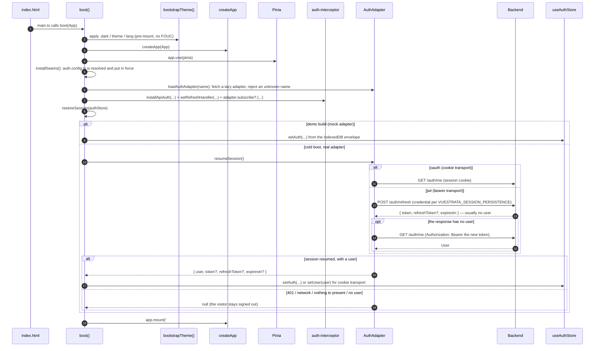

`boot()` (`src/modules/app/bootstrap/index.ts`, managed) calls
`restoreSessionForBoot(authStore, …)` from `bootstrap/auth-wiring.ts` after
Pinia is registered, the runtime backends are installed, the auth interceptor
is wired and the modules have registered their permissions. The decision logic lives in
`src/modules/app/plugins/session-restore.ts` as a dependency-injected function
so it is testable without booting an app — the same pattern as
`route-guard.ts`, and for the same reason: this had no test, which is how it
stayed broken.

```ts
export async function restoreSession(deps: SessionRestoreDeps): Promise<void> {
  const { store } = deps

  // Demo builds only: supplied by boot(), and its presence IS the demo branch.
  if (deps.loadDemoSession) {
    const session = await deps.loadDemoSession()
    if (session?.token) {
      store.setAuth(session.user, session.token, session.refreshToken, session.expiresIn)
    }
    return
  }

  // A token already in memory means re-entry, not a cold boot.
  if (store.token) {
    await refreshCurrentUser(deps)
    return
  }

  // Cold boot: ask the ADAPTER, which is the only layer that knows where its
  // credential lives. Null means "nothing to resume" — the common case.
  const resumed = await deps.resumeSession?.()
  if (!resumed) return

  // A session with no user is not a session: storing one would leave the app
  // holding a live token while `isAuthenticated` says nobody is signed in.
  if (!resumed.user) return

  if (resumed.token) {
    store.setAuth(resumed.user, resumed.token, resumed.refreshToken, resumed.expiresIn)
  } else {
    // Cookie transport: no token exists to store, and none is invented.
    store.setUser(resumed.user)
  }
}
```

Each adapter implements `resumeSession()` for its own transport:

| Adapter | How it resumes                                                                                                                                                            |
| ------- | ------------------------------------------------------------------------------------------------------------------------------------------------------------------------- |
| `mock`  | Reads the session envelope from IndexedDB (demo builds only).                                                                                                             |
| `oauth` | Calls `GET /auth/me` **unconditionally** — the HttpOnly session cookie is the credential.                                                                                 |
| `jwt`   | Presents whichever refresh credential `VUESTRATA_SESSION_PERSISTENCE` selects (nothing under `none`), then loads the user from `/auth/me` when the refresh returned none. |

`/auth/refresh` is documented to return `{ token, refreshToken, expiresIn }` and
no `user`, and the jwt adapter used to hand that straight to the store as a
resumed session — so a backend built to the documented contract came back from
a reload with a token and `user: undefined`. The adapter now asks `/auth/me`,
passing the fresh token explicitly because the store has none yet, and resumes
nothing when that fails. `restoreSession()` enforces the same rule at its own
boundary, for an adapter a project wrote.

Under `session` and `local`, a refresh token the backend rotated is written to
Web Storage **before** `/auth/me` is asked. The store only persists it once the
resume succeeds, and a backend that rotates has already spent the stored one:
if `/auth/me` then failed, the next reload would present a token the backend
reads as replayed. With the rotated token kept, the next reload simply tries
again.

A resumed cookie session carries a user and **no token**. The store's
`isAuthenticated` accounts for that directly:

```ts
const isAuthenticated = computed(
  () => !!user.value && (!!token.value || getAuthTransport() === 'cookie'),
)
```

The previous `!!token && !!user` definition reported every cookie-session user
as signed out, so the route guard bounced them to `/auth/login` on every
protected route even with a valid session.

`resumeSession()` swallows its own failures and answers `null`: a 401 is the
ordinary "no session" reply, and a boot-time resume must never be the thing
that white-screens the app.

---

## 7. Logout

`useAuth().logout()` is structured as **client-side cleanup first**, with
the backend call best-effort:

```ts
async function logout() {
  try {
    await adapter.logout()
  } catch (err) {
    authLogger.warn('Logout API call failed (clearing local session anyway)', { err })
  }
  authStore.clearAuth('logout') // wipes tokens, cancels the refresh timer, emits auth.logout
  clearMfaState() // wipes any pending MFA challenge
  resetFailedAttempts() // resets lockout counter
}
```

A backend that is down must never trap the user in a logged-in state.

Under `refresh-cookie` the logout request is sent with `credentials: 'include'`,
so the backend receives the refresh cookie and can revoke and clear it. It used
to go out with `omit`, and the cookie outlived the sign-out.

### What else ends with the session

`clearAuth()` emits the typed bus event `auth.logout`, with
`{ reason: 'logout' }` for a sign-out, `{ reason: 'expired' }` for an expiry or
a refused refresh, and `{}` when the caller gave none. It fires after the store
is empty, and once per session: clearing a store that holds no session emits
nothing.

`bootstrap/query-client.ts` subscribes when the query plugin is installed:

```ts
appEvents.on('auth.logout', () => {
  queryClient.clear()
  setErrorReporterUser(null)
})
```

TanStack's cache used to outlive the session, so the next person to sign in on
the same tab was shown the previous user's lists until the refetches landed. The
subscription belongs to the app (it is released on unmount), not to a module.

A module that keeps user data of its own — a Pinia store, a draft — resets it
the same way:

```ts
import { appEvents } from '~/lib/events'

appEvents.on('auth.logout', () => useDraftStore().$reset())
```

---

## 8. Authorization (RBAC)

### Role hierarchy

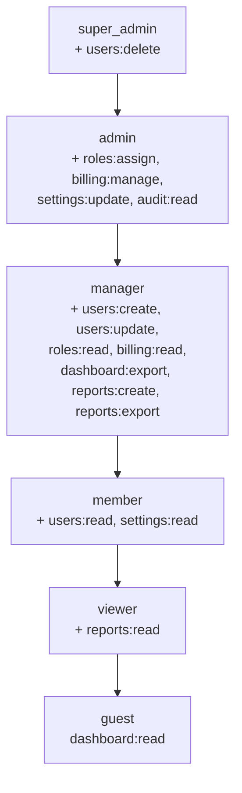

```
ROLE_HIERARCHY = ['super_admin', 'admin', 'manager', 'member', 'viewer', 'guest']
```

`isRoleAtLeast(userRole, required)` returns `true` when `userRole` is
`required` or inherits from it. For the built-in roles that is their order in
the array above. A role the project defines (`roles` in `rbac.overrides.ts`)
has no position: it is at least the roles in its `inherits` chain and no
other, and no built-in role is at least a project role
([core/lib/rbac/role-graph.ts](../../src/modules/core/lib/rbac/role-graph.ts)).
Any unknown role **fails closed** (returns `false`) so a typo or stale enum
value cannot accidentally elevate access.

A user may hold several roles (`roles` beside `role`). `useRbac().isAtLeast()`
and a route's `requiredRole` are met by any of them; `isRoleAtLeast` itself
compares two roles.

### Delta-based role definitions

Each role lists only the permissions it **adds** beyond the next-lower
role. `resolveRolePermissions(role)` walks from `guest` up to the requested
role and unions the deltas. Result is cached per-role only for the lifetime
of the call (no global cache — keeps the engine HMR-safe in dev).

```
guest       → dashboard:read
viewer      → + reports:read
member      → + users:read, settings:read
manager     → + users:create, users:update, roles:read, billing:read,
                dashboard:export, reports:create, reports:export
admin       → + roles:assign, billing:manage, settings:update, audit:read
super_admin → + users:delete
```

### Permission registry

`registerPermissions(namespace, actions)` adds `'<namespace>:<action>'`
strings to a singleton `Set`. The 16 built-in permissions are seeded at
import time; modules add their own during registration.

`validateBuiltinRolePermissions()` is **explicitly invoked from
`initModules`** after every module has registered its permissions. Running
the check at import time would fire false-positive _"unregistered
permission"_ warnings for permissions whose owning module hadn't been
loaded yet.

### `useRbac()` — component API

Three-tier user-source resolution:

1. **Explicit param** — pass `{ role, permissions }` (best for testing).
2. **`provide` / `inject`** — parent component publishes `RBAC_USER_SOURCE_KEY`.
3. **`useAuthStore()` fallback** — derives `role` and `permissions` from the
   active session.

Methods: `can`, `canAny`, `canAll`, `canNamespace`, `isAtLeast`, `hasRole`.
`role` is the primary role and `roles` every role the user holds that the app
declares. Each permission check
emits an `AuthorizationEvent` so audit/analytics hooks see every
component-level decision.

### One answer for the guard and the UI

What a user holds is decided in one place,
`resolveSubjectPermissions(user)` in `core/lib/rbac/identity.ts`: the explicit
`user.permissions` when the backend sent them (an empty array included), else
the union of what each of the user's roles grants through the hierarchy and the
project's grants, and nothing for nobody. `resolveSubjectRoles(user)` beside it
is the one place a role name the app does not declare is dropped. The auth store's `userPermissions`, `useRbac()`, the sidebar
(through `useRbac`) and the route guard all resolve through it.

They used to answer separately. The store handed the guard
`user?.permissions ?? []`, which is never `undefined`, so the guard never fell
back to the role, while `useRbac` and the sidebar did. A backend that described
a user by role alone got a sidebar full of links that all ended at `/403`.
`test/unit/app/rbac-parity.test.ts` holds the three surfaces to one answer for
role-only, permissions-only, both, neither and every built-in role, and
`rbac-roles-parity.test.ts` does the same for a user with several roles and for
a role of the project's own.

### Resource-scoped predicates

When ownership matters, register a predicate:

```ts
registerPredicate('users:update', ({ ownerId, currentUserId }) => ownerId === currentUserId)
```

`hasPermission(role, perms, 'users:update', { ownerId, currentUserId })`
runs the predicate first; if it returns `null` (no predicate registered or
context missing required keys), the standard role check applies. Predicates
**override** the role check when they return a boolean — a non-owner cannot
edit even if their role grants `users:update`.

### Authorization hooks

```ts
onAuthorizationCheck((event) => {
  if (!event.granted) analytics.track('access_denied', event)
})
```

Hooks fire for guard-, component-, and predicate-level checks. They are:

- **Synchronous** — runs in the same tick as the check.
- **Failure-isolated** — a throwing hook is logged but does not block
  others or affect the decision.
- **Multiple subscribers** — each `onAuthorizationCheck` call returns its
  own unsubscribe.

### Router guard

#### Guard decision flow

```mermaid
flowchart TD
  Start([navigation -> to]) --> A{requiresAuth<br/>and signed out?}
  A -- yes --> Login[/redirect /auth/login<br/>?redirect=to.fullPath/]
  A -- no --> B{role or permission<br/>constraint?}
  B -- no --> Allow([next])
  B -- yes --> C{requiredRole?}
  C -- yes --> C1{isRoleAtLeast?}
  C1 -- no --> F403[/redirect /403/]
  C1 -- yes --> D
  C -- no --> D{permissionContext?}
  D -- yes --> D1{resolver throws?}
  D1 -- yes --> F403
  D1 -- no --> E
  D -- no --> E{requiredPermission(s)?}
  E -- no --> Allow
  E -- single --> E1{hasPermission?}
  E -- multi/all --> E2{hasAllPermissions?}
  E -- multi/any --> E3{hasAnyPermission?}
  E1 -- yes --> Allow
  E2 -- yes --> Allow
  E3 -- yes --> Allow
  E1 -- no --> F403
  E2 -- no --> F403
  E3 -- no --> F403
```

#### Guard sequence

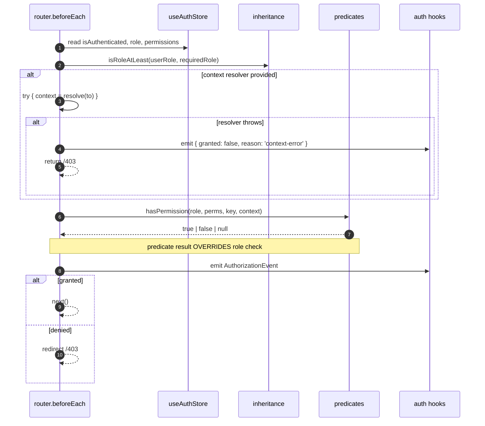

The decision is the pure function `resolveRouteAccess(route, subject)` in
`plugins/route-guard.ts`; `router.ts` only turns its answer into a navigation.

```ts
export function resolveRouteAccess(route: GuardedRoute, subject: GuardSubject): GuardDecision {
  if (route.meta.requiresAuth === true && !subject.isAuthenticated) {
    return { type: 'login', redirect: route.fullPath }
  }

  const hasRbacConstraint =
    route.meta.requiredRole !== undefined ||
    route.meta.requiredPermission !== undefined ||
    (route.meta.requiredPermissions?.length ?? 0) > 0
  if (!hasRbacConstraint) return { type: 'allow' }

  // Runs for EVERY visitor: an anonymous subject evaluates as `guest`.
  // Any role the user holds can meet `requiredRole`; without a list, `role` alone.
  const { role, permissions } = subject
  const meetsRole = (required: Role) =>
    subject.roles?.length ? anyRoleAtLeast(subject.roles, required) : isRoleAtLeast(role, required)
  if (route.meta.requiredRole && !meetsRole(route.meta.requiredRole)) {
    return { type: 'forbidden' }
  }

  let context: Record<string, unknown> | undefined
  if (route.meta.permissionContext) {
    try {
      context =
        typeof route.meta.permissionContext === 'function'
          ? (route.meta.permissionContext(route) ?? undefined)
          : route.meta.permissionContext
    } catch {
      // FAIL CLOSED — a context resolver that throws cannot be trusted
      // to provide the data a predicate needs.
      emitAuthorizationEvent({/* ... */})
      return { type: 'forbidden' }
    }
  }

  // Multi-permission (precedence) or single-permission check…
}
```

Three security-critical behaviours:

1. **Role and permission checks apply to anonymous visitors.** They used to
   sit inside an `isAuthenticated` branch, so a route declaring
   `requiredPermission` without `requiresAuth: true` was open to anyone signed
   out. An anonymous visitor now evaluates as `guest` and is sent to `/403`.
2. **Context resolver throws → `/403`.** Previously the guard fell back to
   the base role check, which silently bypassed the resource-scoped
   predicate (potential escalation). It now denies.
3. **Multi-permission `mode: 'all'` is the default.** Routes that require
   any-one-of-N must opt in explicitly (`permissionMode: 'any'`).

---

## 9. Threat model & defences

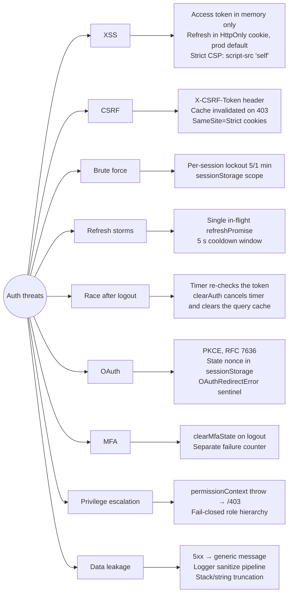

| Threat                                    | Mitigation                                                                                                                                                                                                                            |
| ----------------------------------------- | ------------------------------------------------------------------------------------------------------------------------------------------------------------------------------------------------------------------------------------- |
| **XSS-stolen tokens**                     | The access token lives in JS closures and is never persisted. The refresh token belongs in an HttpOnly cookie (`refresh-cookie`, the production default); `session`/`local` put it in Web Storage, where an XSS can read it.          |
| **CSRF**                                  | Cookie transport only: `X-CSRF-Token` from the `<meta>` tag on every mutating request; cache invalidated on 403; `credentials: 'include'` only when cookie auth is used.                                                              |
| **Brute-force login**                     | Client-side lockout (5 attempts → 1 min cool-off) in `sessionStorage`. A UX guard only; enforce real rate limiting on the backend.                                                                                                    |
| **Refresh storms**                        | Single in-flight refresh + 5 s cooldown window in the API interceptor.                                                                                                                                                                |
| **Race after logout**                     | Refresh-timer guard re-checks `token` before firing; cleared inside `clearAuth()`, which also empties the query cache through `auth.logout`. A refresh still in flight is tied to its session and its answer is dropped (§5).         |
| **Open redirect after sign-in**           | `safeRedirectPath` honours `?redirect=` only for an in-app path: a single leading `/`, no backslash, no control character, before and after decoding.                                                                                 |
| **OAuth promise hang**                    | `OAuthRedirectError` sentinel signals "page about to redirect" so callers don't increment lockout or block UI.                                                                                                                        |
| **MFA token leak across logout**          | `clearMfaState()` runs in `logout` and after successful verification.                                                                                                                                                                 |
| **Privilege escalation via guard bypass** | `permissionContext` resolver failure now redirects to `/403`.                                                                                                                                                                         |
| **Permission typos**                      | `validatePermissions()` runs after module registration; unregistered keys are logged.                                                                                                                                                 |
| **Backend leakage in error UI**           | 5xx messages replaced with generic copy by `normalizeError`, which every `apiFetch` failure passes through; no URL or query string in any message.                                                                                    |
| **PII in logs**                           | `logger` runs every argument through `sanitize()`, which redacts keys named exactly `password`, `secret`, `cookie` and a few more, or containing `token`, `authorization`, `api_key`, `refresh`. Logs only; `reportError()` skips it. |

OWASP Top 10 alignment:

- **A01 Broken Access Control** — fail-closed role hierarchy + guard, predicates for ownership, audit hooks.
- **A02 Cryptographic Failures** — PKCE for OAuth; access tokens held in memory only. The `jwt` adapter persists its refresh token only when `VUESTRATA_SESSION_PERSISTENCE` is `session` or `local`, and the `oauth` adapter's credential is the HttpOnly session cookie. The `mock` adapter does persist its tokens to IndexedDB, but exists only in demo builds.
- **A03 Injection** — strict CSP (`script-src 'self'`), no `eval`, sanitised theme/locale read in [bootstrap-theme.ts](../../src/modules/app/plugins/bootstrap-theme.ts).
- **A05 Security Misconfiguration** — full security header set in `_headers` and the nginx config; Docker runs unprivileged with read-only FS.
- **A07 Identification & Auth Failures** — MFA flow, lockout, secure refresh dedup.

---

## 10. Extension cookbook

### Adding a new permission

```ts
// src/modules/<your-module>/index.ts
const myModule: ModuleDefinition = {
  config: {
    id: 'reports',
    permissions: ['read', 'create', 'export'], // → reports:read, reports:create, reports:export
    // ...
  },
}
```

The module loader calls `registerPermissions(config.id, config.permissions)`
during `initModules`. The validator picks them up automatically.

### Adding a new role

Most of the time what is wanted is not a new role but a different set of
permissions for an existing one, and that needs no edit to anything of
Vuestrata's: `grants` and `withdrawn` in
`src/modules/app/config/rbac.overrides.ts`, as
[Add a permission](../9.recipes/7.add-a-permission) describes.

A role that is genuinely new is declared and defined in the same file, and
nothing under `core/lib/rbac/` is edited (an edit there stops the file
receiving updates):

```ts
// src/modules/app/config/rbac.overrides.ts
declare module '~/lib/rbac/types' {
  interface AppRoles {
    auditor: true
  }
}

export default defineRbacOverrides({
  roles: {
    auditor: {
      inherits: ['viewer'],
      label: 'Auditor',
      description: 'Read-only audit log access',
    },
  },
  grants: {
    auditor: ['audit:read'],
  },
})
```

`inherits` is what places it: the role holds what those roles hold, plus its
grants. Nothing inherits from it unless another of your roles says so, and the
built-in hierarchy cannot be rearranged. Labels, role pickers, users with
several roles and identity-provider claims are in
[Add a permission or a role](../9.recipes/7.add-a-permission#add-a-role).

### Plugging in a real backend

Everything below is written in one file, `src/modules/app/config/auth.config.ts`,
which is yours. No file under `src/modules/auth/adapters/` or `core/lib/` is
edited: those are Vuestrata's, and an edit there costs the file its updates.
[Write your own auth adapter](../9.recipes/10.write-your-own-auth-adapter) is the
worked version of this list.

**A REST backend that issues bearer tokens** keeps the built-in `jwt` adapter
(`VUESTRATA_AUTH_ADAPTER=jwt`) and describes itself:

1. `endpoints`: the paths and methods that differ from
   [the defaults](2.auth-rbac#backend-endpoints). Set an endpoint the backend
   does not have to `null`; the capability, the adapter method and the control
   in the UI go with it.
2. `mapAuthResponse` (and `mapRefreshResponse`, `buildRefreshBody`): when the
   token fields are not `token` / `refreshToken` / `expiresIn`.
   `authResponseMappers.snakeCase` and `.oauthToken` cover the two common
   shapes. A login that returns no `user` is followed by a request to the `me`
   endpoint.
3. `mapUser`: when the user record is not shaped like `User`. Its result is
   validated: `id` and `email` are required, a missing `name` is the email, a
   missing `role` is `guest` with no permissions, and a payload that drifts
   beyond that (no `id`, an array for a role) fails the sign-in as a
   `CONTRACT_MISMATCH`.
4. Choose `VUESTRATA_SESSION_PERSISTENCE` for where the backend keeps the
   refresh credential. For the default, `refresh-cookie`, the backend sets it in
   an `HttpOnly; Secure` cookie and does the rest of what
   [`refresh-cookie` needs](1.environment#what-refresh-cookie-needs-from-the-backend).

**A backend-for-frontend with a cookie session** keeps the `oauth` adapter and
configures the same keys, plus `providers` for the sign-in buttons. Add a
`<meta name="csrf-token">` to the HTML it serves if it uses double-submit-cookie
CSRF; otherwise rely on `SameSite` cookies alone.

**Anything else** — an SDK that owns the session, a protocol no built-in adapter
speaks — is an adapter of your own:

1. Write a factory, `(options) => AuthAdapter`, in a module of yours.
   `login`, `logout` and `getUser` are required; every optional method is
   paired with a `capabilities` flag.
2. Register it under `adapters`, by the name `VUESTRATA_AUTH_ADAPTER` will
   select it with: `sdk: { transport: 'bearer', load: () => import('~/auth/sdk-adapter') }`.
   The build reads that name, and the transport, from the file's text, so write
   the entry inline with a literal transport; a registration held in a variable
   fails the build. Declare the name in the same file
   (`interface RegisteredAuthAdapterNames { sdk: true }`) so its type is known.
   Nothing else is added anywhere: not to `SUPPORTED_AUTH_ADAPTERS`, not to
   the env schema.
3. Implement `resumeSession()`: `restoreSession()` calls it on a cold boot to
   rehydrate the user on page load. It must resolve to a session **with a
   user**, or to `null`; a userless one is discarded.
4. Implement `refreshSession()` (and `canRefreshSession()` if there are times
   it has nothing to present), returning `{ token, refreshToken?, expiresIn? }`.
   The 401 interceptor and the proactive timer both call it through the provider
   the bootstrap installs. An adapter without it gets the interceptor's own
   `POST /auth/refresh` with a `{ refreshToken }` body, which only works while
   the store holds a refresh token.
5. For an SDK: implement `subscribe(listener)` and declare
   `persistence: 'external'`. Report changes in the SDK's order with a
   `sequence`, drop the result of asynchronous work a later event overtook, and
   make `logout()` end the SDK's session (§3 has the rules the bootstrap applies
   in return). The user is held to the same contract as a REST backend's either
   way; building it with `parseUser()` says so where the mapping is.

### Writing tests

Use `useRbac` with explicit user source to avoid Pinia setup:

```ts
const { can } = useRbac({
  role: ref<Role>('manager'),
  permissions: ref<Permission[]>(['users:read']),
})

expect(can('users:read')).toBe(true)
expect(can('users:delete')).toBe(false)
```

For auth-store flows, register a stub adapter. This is the same mechanism a
project's own adapter uses, so nothing is mocked:

```ts
import { installAuthConfig, resolveAuthConfig } from '@/lib/auth'
import { createAuthAdapter } from '@/modules/auth'

installAuthConfig(resolveAuthConfig({ adapters: { stub: () => stubAdapter } }))
const adapter = createAuthAdapter('stub')

afterEach(() => installAuthConfig(resolveAuthConfig())) // back to the shipped configuration
```

To test a configured backend end to end, install the configuration and drive
the real `jwt` adapter against `msw/node`, as
`test/integration/auth/snake-case-backend.test.ts` does.

Authorization hooks make integration testing easy:

```ts
const events: AuthorizationEvent[] = []
const off = onAuthorizationCheck((e) => events.push(e))
// ...trigger flow...
off()
expect(events).toContainEqual(expect.objectContaining({ permission: 'users:read', granted: true }))
```

---

## 11. File map

```
src/modules/auth/
├── adapters/
│   ├── types.ts                    # re-exports the contract; adapter list, error classes
│   ├── registry.ts                 # createAuthAdapter: the built-in adapters, then the registered ones
│   ├── base.ts                     # authEndpoints (a view of the configured calls), assertOAuthProvider
│   ├── mock.ts                     # demo adapter, bearer transport; not in a production bundle
│   ├── jwt.ts                      # bearer tokens + isJwtExpired
│   ├── oauth.ts                    # authorization code + PKCE, cookie transport
│   ├── session.ts                  # the backend’s own session cookie + CSRF; no token, no refresh
│   ├── pkce-state.ts               # sessionStorage handshake state + TTL
│   └── index.ts                    # the adapters' exports, requireCapability
├── composables/useAuth.ts          # orchestration only: store wiring, redirects, lockout
├── lib/pkce.ts                     # verifier / challenge / state generation
├── lib/safe-redirect.ts            # safeRedirectPath: which ?redirect= values are honoured
├── stores/challenge.ts             # lockout counter + MFA challenge
├── mocks/auth.handlers.ts          # MSW handlers (demo builds only)
└── pages/                          # login, register, callback

src/modules/app/
├── config/auth.config.ts           # yours: endpoints, mappers, providers, your own adapters
├── stores/auth.ts                  # in-memory token store, refresh scheduler
├── composables/useRbac.ts          # component-facing permission API
├── state/demo/                     # demo boundary — see §2
│   ├── index.ts                    # the only entry point, behind __VUESTRATA_DEMO__
│   ├── account.ts                  # DEMO_ACCOUNT, single source of truth
│   └── seed.ts                     # seeds the demo super-admin
└── plugins/
    ├── router.ts                   # installs the guard
    ├── route-guard.ts              # resolveRouteAccess() — pure, unit-tested
    └── bootstrap-theme.ts          # pre-mount FOUC guard (theme, dark, locale)

src/modules/core/lib/
├── config/env.schema.ts            # zod env validation, shared with vite.config.ts
├── auth/                           # importable as ~/lib/auth
│   ├── adapter.ts                  # the AuthAdapter contract (types)
│   ├── config.ts                   # defineAuthConfig, resolveAuthConfig, getAuthConfig
│   ├── endpoints.ts                # createAuthEndpoints, endpoint presets, response mappers
│   ├── user.ts                     # the User schema every identity response is held to
│   ├── registry.ts                 # a project's own adapters: build one, load a lazy one
│   └── session-persistence.ts      # where a refresh token may be kept
├── runtime.ts                      # the slots; installAuthConfig() puts auth.config.ts in force
├── api/
│   ├── client.ts                   # apiFetch + transport-aware credentials/CSRF, 401 replay
│   ├── auth-interceptor.ts         # 401 → refresh dedup + cooldown; delegates to provider.refresh()
│   ├── failure.ts                  # toAppError, Retry-After, URL redaction
│   ├── retry.ts                    # the TanStack Query retry policy
│   └── types.ts                    # ApiAuthProvider (refresh/canRefresh) + ApiAuthTransport
├── rbac/
│   ├── registry.ts                 # permission Set + validator
│   ├── inheritance.ts              # delta-based role resolution
│   ├── identity.ts                 # resolveSubjectPermissions: what a user holds
│   ├── checks.ts                   # has/Any/All permission
│   ├── predicates.ts               # resource-scoped overrides
│   ├── hooks.ts                    # authorization event bus
│   └── index.ts                    # barrel + validateBuiltinRolePermissions()
├── errors/
│   ├── index.ts                    # AppError + normalizeError (5xx hardening)
│   └── reporter.ts                 # error-reporting adapter (no-op by default)
└── logger/index.ts                 # PII-sanitising consola wrapper

src/main.ts                         # yours: boot(App) and nothing else
src/modules/app/bootstrap/          # managed: the boot sequence
├── index.ts                        # boot(): pinia → backends → seams → adapter → auth interceptor → modules → restore → mount
├── auth-wiring.ts                  # setupAuthInterceptor, proactive refresh, adapter.subscribe, expiry redirect, restoreSessionForBoot
├── query-client.ts                 # Vue Query options and retry policy; clears the cache on auth.logout
├── boot-error.ts                   # renderBootFailure()
├── seams.ts                        # installSeams(): resolves and installs the project's auth.config.ts
└── demo.ts, mocks.ts               # demo-only, behind __VUESTRATA_DEMO__
```

---

## 12. Change checklist for auth-touching PRs

Before merging anything in this surface, verify:

- [ ] **No access token persisted to storage.** Only the refresh token may be, and only through `core/lib/auth/session-persistence.ts` under `session`/`local`. Search for `localStorage.setItem.*token` / `sessionStorage.setItem.*token`.
- [ ] **Adapter contract preserved.** Every `AuthAdapter` method is implemented; no caller does `(adapter as any).foo()`. A member added to the contract is optional and feature-detected.
- [ ] **The default wire contract is unchanged.** `test/integration/auth/default-wire-contract.test.ts` passes without edits; a change to it is a change to every project's backend contract.
- [ ] **No backend is integrated by editing an adapter.** A path, a field name or a user shape that differs goes in `auth.config.ts`.
- [ ] **Refresh path tested.** Trigger 401 → verify single refresh, retry, and session-expired escalation. `test/integration/auth/refresh-cookie.test.ts` does it per persistence mode, and asserts `credentials` on every `/auth/*` request.
- [ ] **Guard and UI still agree.** `test/unit/app/rbac-parity.test.ts` passes; nothing resolves a user's permissions except `resolveSubjectPermissions`.
- [ ] **Nothing of the previous user survives `clearAuth()`.** State a module keeps per user is reset on `auth.logout`.
- [ ] **Lockout still bounded.** Failed attempts increment, lockout expires, `sessionStorage` keys honoured.
- [ ] **Guard fail-closed.** Throwing `permissionContext` resolver still redirects to `/403`.
- [ ] **Permission validation runs after register.** `validateBuiltinRolePermissions` is called from `initModules`, not at import.
- [ ] **CSRF cache invalidated on 403.** `getCsrfToken` re-reads after an auth-server token rotation.
- [ ] **Logger sanitisation respected.** New log calls don't bypass `createScopedLogger`.
- [ ] **5xx error messages stay generic** in `normalizeError`, which every `apiFetch` failure passes through.
- [ ] **Quality gates pass:** `vp check` and `vpr test` clean.
